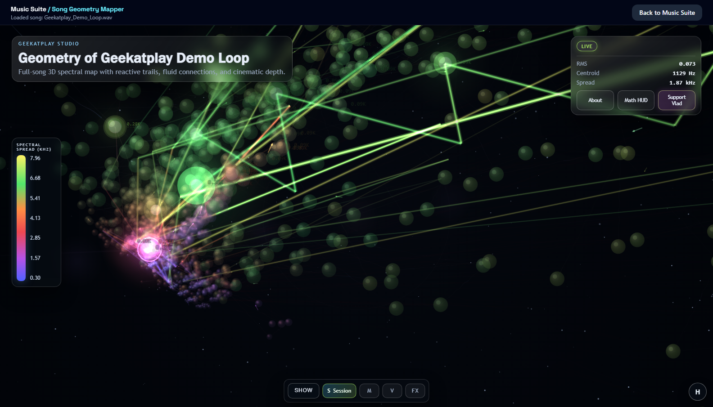
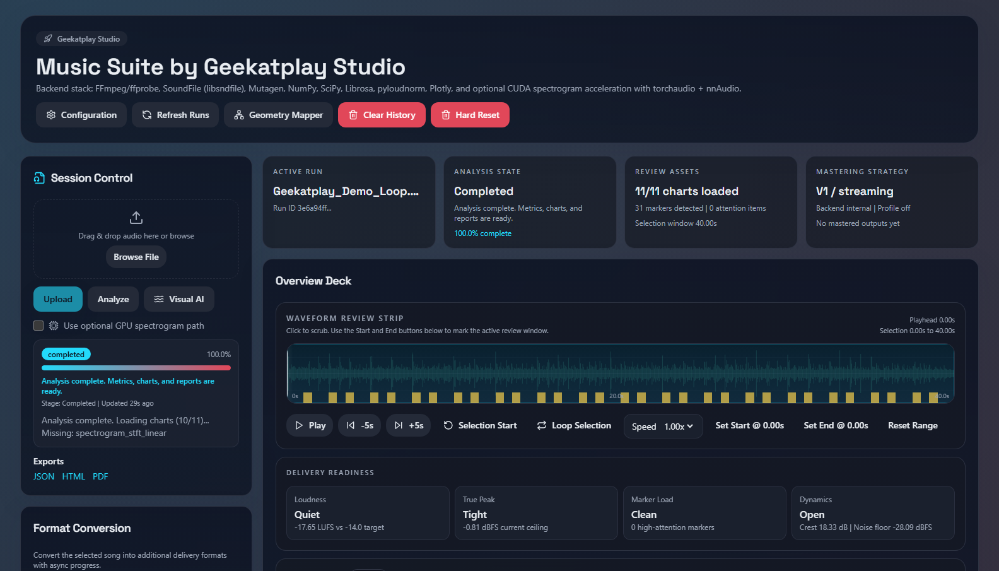
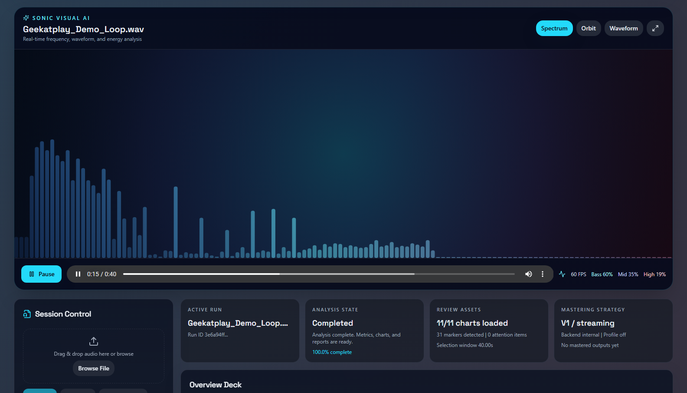
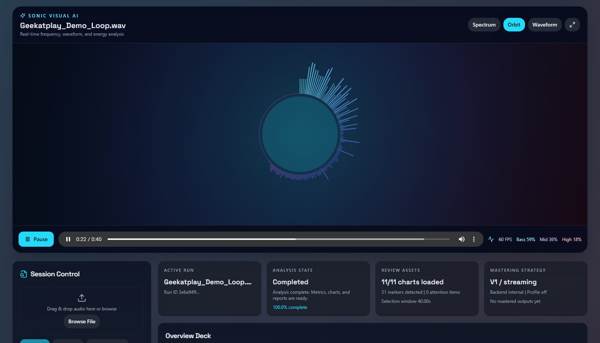
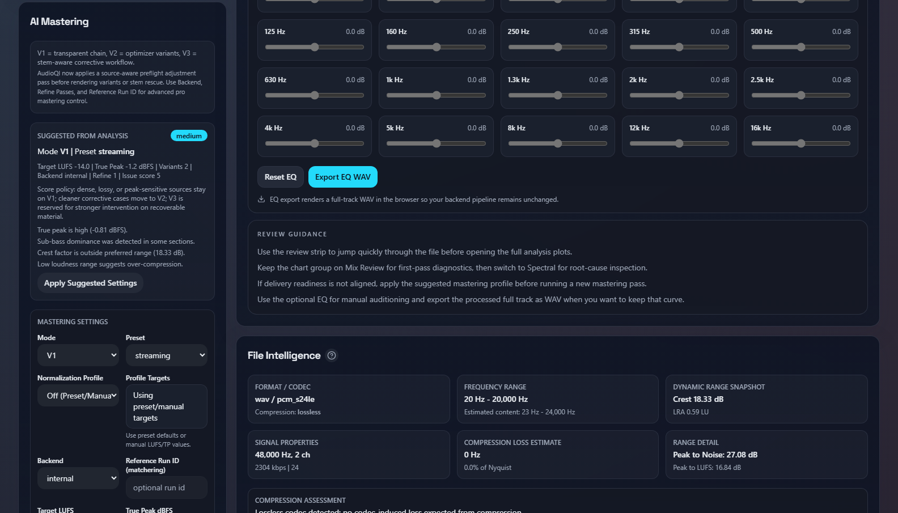
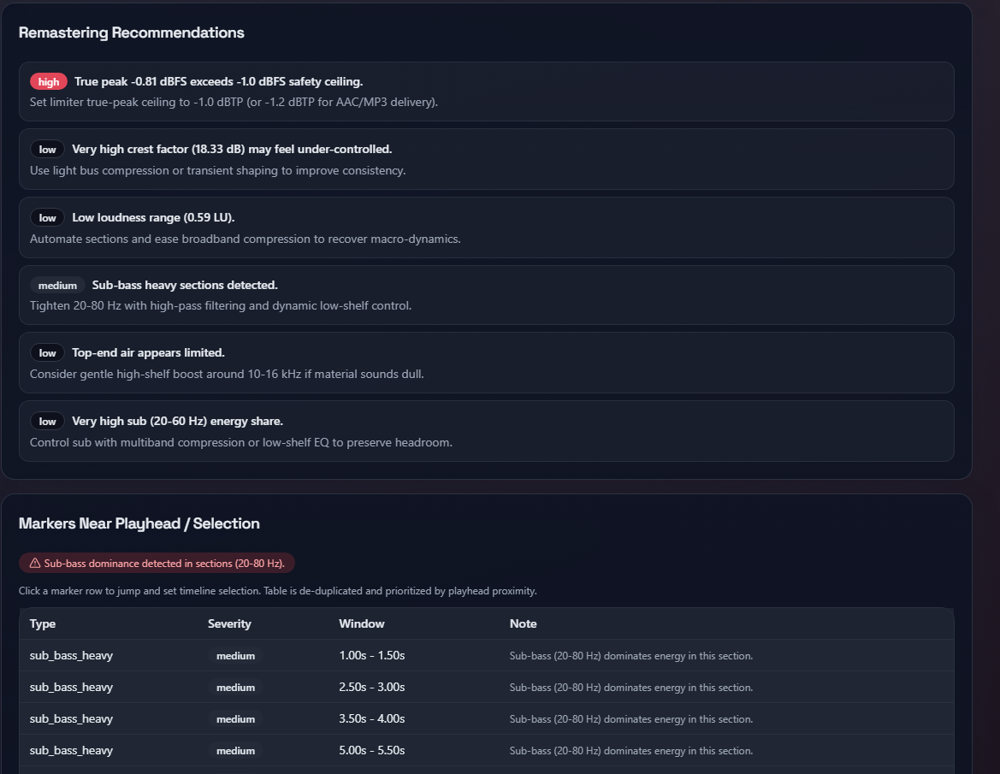
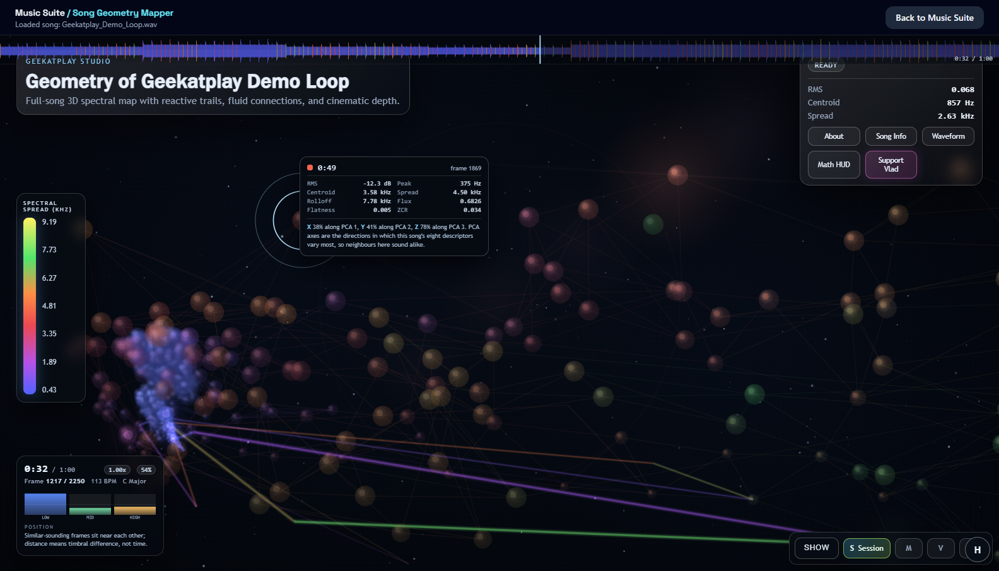
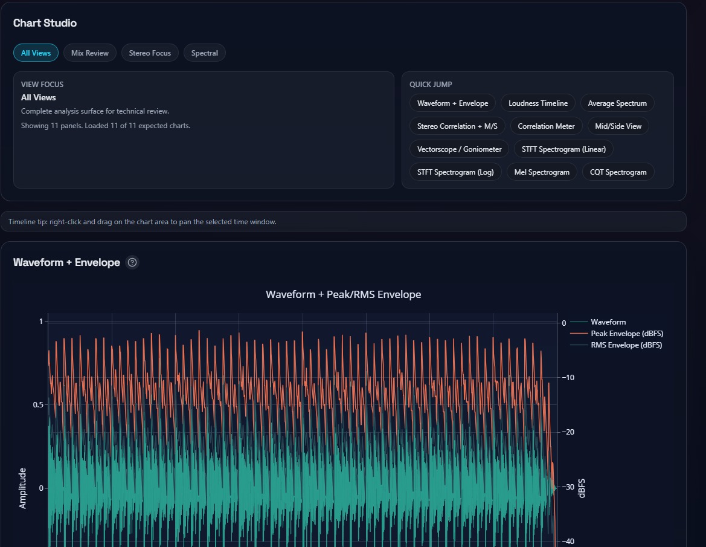
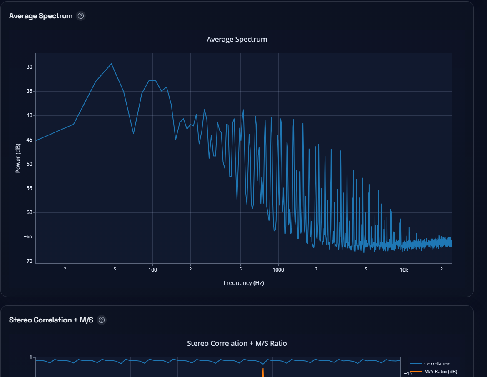

<div align="center">

# 🎛️ Geekatplay Studio Music Suite

**Local-first music analysis, AI-assisted mastering, a multitrack audio and MIDI editor, real-time visualization, and 3D song geometry — in one application.**

[](LICENSE)
[](pyproject.toml)
[](apps/web-next/package.json)
[](apps/api/main.py)
[](apps/web-next)
[](GUARDRAILS.md)

Created by **Vladimir Chopine** · [GeekatplayStudio/music-suite](https://github.com/GeekatplayStudio/music-suite)



<sub>Song Geometry Mapper — a full-song 3D spectral map with an always-on readout, a seekable waveform scrubber, and structural arcs linking passages that recur.</sub>

</div>

---

## What it is

Music Suite is a desktop-style application that runs on your own machine. Upload a track and it gives you broadcast-grade measurements, an explainable mastering chain, a multitrack editor for cutting, repairing, mixing and composing, real-time visuals, and a 3D map of the song's spectral geometry — without uploading your audio anywhere.

The former **AudioQI Analyzer** and **Sonic Visual AI** projects now share one codebase, interface, installer, startup workflow, dependency set, and release lifecycle. Sonic Holodeck ships as an optional ComfyUI integration rather than a second application.

| | |
|---|---|
| 🎚️ **Measure** | Loudness (LUFS), true peak, crest, LRA, stereo correlation, phase, spectrum, and four spectrogram types |
| 🤖 **Master** | Internal, FFmpeg, Pedalboard, and Matchering paths with per-stage progress, marker-aware refinement, and a regression guard that refuses passes which add glare |
| ✨ **Create** | AI Song Studio: write lyrics and a style with a local language model, then generate full songs with vocals on this computer (ACE-Step 1.5). Or start from a song you have: match its tempo, key and feel, restyle it, extend it, add a part, or build a song around a vocal |
| 🔁 **Move** | Send any song between the analyser, the AI Song Studio and the Studio Editor in one click. It is always added (to a new or existing session, on a new track) and never replaces your work, and can be split into stems on arrival |
| ✂️ **Edit** | Multitrack Studio Editor: waveform clips, stem separation up to 12 stems (drum kit pieces, lead and backing vocals), repair tools, a spectral view, mixing with buses and automation, voice effects (vocoder, pitch shift, robot), recording, MIDI with a piano roll and a live MIDI keyboard, and AI tempo/key matching |
| 🌈 **Visualize** | 60 FPS Spectrum, Orbit, and Waveform modes driven by the Web Audio analyser |
| 🪐 **Map** | Full-song 3D geometry with tempo and key estimation, structural repeat detection, per-node inspection, presets, overlays, and exports |
| 🧠 **Describe** | Local Ollama model writes the track's style, always shown beside the description derived from the measurements |
| 🔌 **Integrate** | Guarded local MCP server, plus optional ComfyUI nodes for music generation |
| 🔒 **Stay local** | Loopback-only binding, no cloud calls for audio, explicit opt-in for every mutation. The network features — in-browser editor plugins and the online song services — stay off until you switch them on |

---

## Screenshots

### Unified workspace

Upload, analysis state, delivery readiness, and the waveform review strip on one surface.



### Real-time Visual AI

Spectrum and Orbit modes render from live playback at 60 FPS with per-band energy readouts.

<table>
<tr>
<td width="50%"></td>
<td width="50%"></td>
</tr>
<tr>
<td align="center"><sub>Spectrum</sub></td>
<td align="center"><sub>Orbit</sub></td>
</tr>
</table>

### AI mastering with explanations

Every suggestion states its reasoning, and the source-aware preflight explains why a mode and preset were chosen.



Mastering reports every step it starts — high-pass, spectral tilt, de-essing, compression, limiting, then each refinement pass — along with how long the current step has been running. A stage that legitimately takes two minutes is otherwise indistinguishable from a hung one.

The refinement loop will not accept a pass that trades one problem for another: a candidate that materially increases harshness, clipping, true-peak risk, or mono incompatibility is refused however much its aggregate score improves.

### Actionable remastering notes

Findings are ranked by severity and tied to concrete time windows rather than generic advice.



> **Reading band-ratio markers.** `harshness_band` and `sub_bass_heavy` are both measured as a share of total energy, so they compete: correcting a bass-heavy master raises the 3–9 kHz *share* even when its absolute energy is unchanged. A master that cuts `sub_bass_heavy` sharply can therefore show more `harshness_band` windows without having gained any actual glare. Compare the self-check's before/after counts as a set rather than judging one marker type alone.

### Measurements that refuse to guess

Some numbers can't be measured on every track. When that happens the suite shows N/A with the reason, instead of a misleading figure.

- **Noise floor** is read only where the music drops out: fades, gaps and quiet intros at least 40 dB below the track's median level. A dense track with no such passages shows **N/A — the music masks it**. The old estimator reported the quietest *music* here, so a clean chillwave master could show a "noise floor" of −21 dBFS. Peak-to-noise follows the same rule.
- **Compression loss** is measured against the audible band (20 kHz, or Nyquist for low sample rates), not against Nyquist. A 48 kHz lossless file with content up to 20 kHz now reads 0 Hz lost instead of 3 820 Hz. A *lossless* file whose content stops below 16 kHz is flagged as likely transcoded from a lossy source.
- **"Top-end air appears limited"** compares the per-octave level of 10–20 kHz with the 1–4 kHz level. It no longer uses a fixed 4 % energy share, a test that nearly every normal master failed. If the source simply stops early, the note says so, because a high-shelf boost can't restore content that isn't there.
- **LRA** applies the EBU Tech 3342 gates (−70 LUFS absolute, −20 LU relative), so silence and fades no longer stretch it.

Runs analysed before these fixes show N/A for the affected fields until you re-analyze them.

> **What mastering can and cannot do.** Mastering changes how a track *sounds*: loudness, tone, peaks, stereo. It doesn't change how the track was *made*. AI-music detectors look for the fingerprints a generator leaves in the audio, such as periodic spectral peaks from neural vocoders and stem-level vocal signatures. EQ, compression and limiting pass those through unchanged, so mastering an AI-generated track won't change a detector's verdict, and the suite doesn't try to. To make a track genuinely human-made or hybrid, replace generated parts with performed ones; re-recording the vocal matters most.

### Song geometry you can read

Every point is one analysis frame. Hover any node for its eight spectral descriptors and a sentence explaining why the active mapping mode placed it at that coordinate — the axes are never left unexplained.



The lower-left readout carries elapsed time, playback rate, position, frame index, a low/mid/high band meter, and the estimated tempo and key. **Both estimates carry a confidence and read `unclear` rather than printing a number the data does not support** — tempo comes from autocorrelating the spectral-flux onset envelope, key from Krumhansl-Schmuckler correlation over a long-window chroma.

### Chart studio

Eleven interactive Plotly panels grouped into Mix Review, Stereo Focus, and Spectral views.

<table>
<tr>
<td width="50%"></td>
<td width="50%"></td>
</tr>
</table>

<sub>Screenshots show a synthetic demo loop generated for documentation, so no third-party music appears in this repository.</sub>

---

## Studio Editor

Open it from the **Studio Editor** button in the workspace (it opens the selected song) or at `/editor`. A session holds any number of tracks; nothing you do changes the original files, and every edit can be undone.

| Area | What you can do |
|---|---|
| **Arrange** | Move, trim, split, duplicate and reverse clips; fades with linear, equal-power or S-curve shapes; automatic crossfades where clips overlap; ripple delete; snapping; markers; named sections you can repeat or cut out as a block |
| **Separate and transform** | Split a song into 2, 4 or 6 stems on aligned tracks; time-stretch, pitch-shift, warp markers and beat quantise (Rubber Band); match a clip's tempo and key to the project or to another clip |
| **Repair** | Noise reduction with an optional noise print, DeClick, DeHum, DeClip, DeReverb, loudness normalise, and a spectral view where you box a sound and attenuate or heal it |
| **Mix** | Per-track EQ, gate, voice effects, distortion, compressor, delay and reverb; buses and sends; automation lanes for volume, pan, EQ and effect settings; a true-peak limiter; EBU R 128 loudness and a phase scope |
| **Voice** | Robot-singer vocoder (follows the sung pitch, holds one note, or takes its notes and chords from a MIDI keyboard), chipmunk and monster pitch shift, ring-modulator robot, a synth voice that follows your pitch, and megaphone distortion, with presets |
| **Record** | Uncompressed recording with punch-in, loop recording into take lanes you can comp, and MIDI-keyboard performances recorded as notes |
| **Compose** | Instrument tracks with a built-in synth (3 oscillators with unison, FM, noise, 12/24 dB filter with drive, 2 envelopes, 2 tempo-syncable LFOs, an 8-route modulation matrix, mono glide, 17 levelled presets) or drum kit, a piano roll, a sheet-music view of any MIDI clip, an on-screen piano, live playing from a USB MIDI keyboard (velocity, sustain pedal, pitch bend), computer- or MIDI-keyboard note input, MIDI file import/export, audio-to-MIDI, and automatic song-section detection |
| **Plugins** | VST3 and Audio Units rendered in an isolated process: effects on audio clips, and instruments such as Surge XT that play a MIDI clip into a new audio track (Surge XT installs in one click; search its 3,000 sounds and hear each one live with Play and Stop, or open the plugin's own window). Web Audio Module effects that run live in the browser (opt-in, see below) |
| **Synth Studio** | A page of its own for designing sounds: every synth control on one responsive screen, a piano that plays by mouse, touch or computer keys and fits its octaves to the screen width, presets and saved sounds shared with the editor, a tab to audition Surge XT's 3,000 sounds with Play and Stop, live playing of Surge XT from the piano or a MIDI keyboard (about 15–25 ms from key to sound), favourites shared with the editor, and export/import of any sound as a `.mssound` file |
| **Generate** | Describe a part and a local ComfyUI (MusicGen, via the bundled Sonic Holodeck nodes) generates it at the project tempo |
| **Export** | Mixdown, highlighted range or every track as WAV (24-bit or 32-bit float), FLAC or MP3; or send the mix straight to AI Mastering |

Press `?` in the editor for the full list of keyboard shortcuts.

**Optional engines: Models & engines.** The editor works with the base install and uses built-in fallbacks where a better engine is missing. Open **Models & engines** (a button in every workspace, or `/models`) to see your graphics card and install what you want with one click:

- **AI stem separation**: Demucs, BS-RoFormer and MDX23C models. Splits into 2, 4 or 6 stems (vocals, drums, bass, guitar, piano, other), and further: drums into **kick, snare, toms, hi-hat, ride and crash**, vocals into **lead and backing**. A full split is 12 stems. It also adds AI beat tracking. On Windows with an NVIDIA card it installs PyTorch's CUDA build, so separation runs on the GPU (a 45-second excerpt split into 12 stems in about 20 s on an RTX 3090).
- **AI music**: the AI Song Studio engine, its editing and XL models, and the lyrics writer, in the same list.

Installs never change a package that is already there: every installed version is pinned while pip runs. The same installs work from a terminal (`python -m audioqi.addons list`, `python -m audioqi.addons install stems`), from the installers (`install.ps1 -WithAiStems`, or `MUSIC_SUITE_INSTALL_STEMS=1 ./install.command`), and with `make install-stems`. The `editor` extra (Pedalboard for Rubber Band stretch and VST3/AU, plus noisereduce) is installed by the installers. Some separation models carry non-commercial licences, and Pedalboard and Rubber Band are GPLv3; check them before distributing a bundled build or releasing separated stems commercially.

**MIDI keyboards.** Plug in a USB keyboard (Roland and other class-compliant keyboards need no driver), press the keyboard button beside record, and allow MIDI devices when the browser asks. It plays the selected track; on a track with a MIDI clip, the record button records what you play as notes. Web MIDI works in Chrome and Edge; Safari does not support it. Details are in the [Help Guide](docs/HELP_GUIDE.md).

**In-browser plugins.** Web Audio Modules are third-party JavaScript downloaded from the internet and run inside the editor page. They stay off until you choose *Allow internet plugins in this browser* on a track. Your audio is still processed on this machine, but a plugin can see the open session, so load only plugins you trust. See [GUARDRAILS.md](GUARDRAILS.md).

What is planned next, and exactly what has and has not been verified, is in **[docs/EDITOR_ROADMAP.md](docs/EDITOR_ROADMAP.md)**.

---

## AI Song Studio

Open it from the **AI Song Studio** button in the workspace or at `/generate`.

1. **Install the engine once.** The installer offers it, or press **Install local engine** in the studio. It builds the open-source ACE-Step engine ([acestep.cpp](https://github.com/ServeurpersoCom/acestep.cpp), MIT) and downloads about 5.3 GB of models. After that it works offline.
2. **Describe your song.** *Write style and lyrics* turns an idea into a style description, lyrics with section tags, tempo and key. Edit anything, or type it all yourself.
3. **Generate.** A 2-minute song takes about a minute on an Apple Silicon Mac. Ask for up to four versions; each lands on its own track.
4. **Open in Studio Editor** to cut, mix, separate stems or master the result. Each version also has **Add to a session** (a new or existing one), **Split into stems**, **Analyse** and **Start a song from it**.

**Start from a song:** upload a song (or send one from the analyser or the editor) and the studio measures its tempo, key, time signature and length and drafts a style description from its sound. Then make a new song in its style, restyle it, extend it, extract an instrument, add a part, or build a full song around it. Results land in the song's own session next to the original, which is never deleted.

Every engine control is available under *Advanced* (planner sampling, diffusion steps, solver, models). *History* keeps the settings of each song so you can reuse them. *Settings* covers the lyrics model, the loudness of new songs, and the memory limits that keep the computer responsive: one song at a time, and the engine unloads when idle.

**AI edits in the Studio Editor:** select a clip and use *AI edit* to regenerate a highlighted section, extend it, restyle it, extract an instrument, add a part, or build a full song around it. The last three need the editing model (2.4 GB), offered by the installer and in *Settings*.

**Albums:** the *Album* tab turns a concept and a list of song ideas (up to 20) into an album, written and generated one song after another in the background. It waits for memory instead of failing, carries on after a restart, and opens in the Studio Editor with every song on its own track.

**Higher quality:** *Settings* can download the larger XL music model (4.9 GB). Measured here: a 2-minute song in 80 s instead of 63 s, using 5.0 GB instead of 4.4 GB.

**More engines (optional, off by default):** ACE-Step's own Python server (for NVIDIA machines that already run it) and YuE2 (NVIDIA, 24 GB, non-commercial licence). Switch them on under *Settings ▸ Generators*.

**Online services (optional):** add your own ElevenLabs Music, fal.ai (MiniMax Music, Lyria) or Google Gemini (Lyria 3.5) key under *Settings ▸ Online services* to use them as generators. Only the style text, lyrics and settings are sent; a clip's audio is uploaded only when you tick *Allow uploading* to edit it with ElevenLabs. A cost estimate is shown before every online request. ElevenLabs songs can be planned section by section (*Song plan*, drafted for free), and in the Studio Editor any clip can have a section regenerated or be extended with ElevenLabs. Keys stay in your computer's keychain.

Lyrics are best with [Ollama](https://ollama.com) and the `gemma4:12b` model (about 8 GB); without Ollama the music engine's own planner writes a simpler draft. Measured on an Apple M5 with 24 GB: the engine peaks at 2.3 GB of memory, or 4.5 GB with its planner. On Windows the engine builds with MinGW (for example WinLibs from winget) or Visual Studio; with MinGW it targets Windows 10 and links its runtime in, so it starts without the compiler on `PATH` (built and started on Windows 11; song quality there not yet compared). Linux builds are untested. Plan and benchmarks: [docs/GENERATION_ROADMAP.md](docs/GENERATION_ROADMAP.md).

---

## Requirements

- Windows 10/11 or a current macOS release
- Python 3.12 or newer (librosa 1.0 and numpy 2.5 need it). The installer sets up 3.12 when it finds nothing newer, and recreates a virtual environment built on an older Python
- Node.js 22.13 or newer; the current LTS is recommended, and the installer replaces older versions
- pnpm (recommended) or npm
- FFmpeg and ffprobe on `PATH`
- Git for in-app updates
- Optional: ComfyUI with a compatible Torch/CUDA environment (for music generation)
- Optional: AI stem separation from *Models & engines* (about 3 GB with NVIDIA GPU support, plus 2.2 GB of models)
- Optional, for AI Song Studio: about 6 GB of free disk, CMake and a C++ compiler (the installer adds CMake through Homebrew or winget), and Ollama for the best lyrics

---

## Quick start

### Windows

Double-click `install.bat`, then `start.bat`. Stop it with `stop.bat`.

The `.bat` files call the unified PowerShell implementation. Advanced flags stay available:

```powershell
.\install.ps1 -WithGpu
.\install.ps1 -WithPro
.\install.ps1 -ComfyUIPath "D:\ComfyUI" -InstallComfyDependencies
```

### macOS

Double-click `install.command`, then `start.command`. Use `stop.command` or press Control-C in the startup terminal. If macOS blocks the first launch, Control-click the file, choose **Open**, and confirm.

```bash
./install.command
./start.command
./stop.command
```

The installer asks once whether to add the local AI music engine. To decide ahead of time, or to add it later:

```bash
MUSIC_SUITE_INSTALL_AI=1 ./install.command   # install the engine and editing model without asking (0 skips)
make install-ai                              # add them later; or use the buttons in AI Song Studio
```

Install FFmpeg with Homebrew when needed:

```bash
brew install ffmpeg
```

### From the project root with npm

Works on both platforms and calls the same unified launchers:

```bash
npm run start
npm run stop
npm run install:suite
```

---

## Ports, startup time, and logs

**Ports.** Music Suite prefers `http://127.0.0.1:3000` for the interface and `8008` for its local API. If either is occupied, startup scans upward for the next free loopback port; if that whole window is busy it asks the operating system for any free port. It then displays and opens the selected address. **The application already on your preferred port is never stopped or modified.**

**Startup time.** A cold first start imports the complete audio stack and can take a few minutes on a slow disk, or while antivirus scans the virtual environment. The launchers wait up to **300 seconds** per service and print progress while waiting.

**Logs.** Each service streams to `logs/`:

```text
logs/api.log        logs/api.error.log
logs/web.log        logs/web.error.log
```

If a service fails or times out, the launcher prints the tail of that log instead of an unexplained message. Raise the limit when needed:

```powershell
.\start.ps1 -StartupTimeoutSeconds 600
```

```bash
MUSIC_SUITE_STARTUP_TIMEOUT_SECONDS=600 ./start.command
```

The `MUSIC_SUITE_STARTUP_TIMEOUT_SECONDS` environment variable sets the same value once on either platform.

**Shutdown.** `stop` reads `.music-suite-processes.json` and terminates only the verified PIDs recorded for that project instance and their descendants. It never claims ports 3000/8008, and an unrelated process using either port is left running.

---

## Application workflow

1. Upload or drag in a song.
2. Select **Analyze** for technical and mastering analysis.
3. Select **Visual AI** for the live Spectrum, Orbit, and Waveform experience.
4. Select a run and open **Geometry Mapper** to reuse that song in the full 3D workspace.
5. Open **Studio Editor** to cut, repair, separate, mix or add to the song on a multitrack timeline.
6. Use **AI Mastering** to render and compare mastered outputs.
7. Open **Configuration** to check for updates from the official repository.

The frontend reaches the selected API through a same-origin streaming proxy, so uploads, audio seeking, downloads, MCP discovery, and configuration work without fixed port assumptions. The installer creates an optimized production frontend, and normal startup uses `next start` without development hot-reload WebSockets.

Geometry Mapper runs inside the normal Music Suite web process — Docker and a separate mapper server are not required. Classic analysis runs in the browser; Voice / Deep analysis uses the same loopback FastAPI service and caches under `data/song-mapper`. Optional Demucs stem separation can be enabled with `pip install -e ".[geometry]"`; without it the analyzer falls back to the full mix.

### Inside the mapper

- **Mapping modes** decide how eight descriptors become three coordinates. *Manifold (PCA)* answers "what sounds like what" — distance is timbral difference and time is not an axis. *Time Spine* answers "what happened when". *Hybrid Flow* keeps chronology while pulling repeats together. *Helix Orbit* winds the timeline into a spiral. The About panel and `docs/HELP_GUIDE.md` set out the axes for each.
- **Time as a visible dimension** — temporal fog that fades by distance from the playhead *in time* rather than from the camera, ghost layers showing where the music was and is heading, a time tube encoding loudness along the trail, and section arcs linking passages that recur.
- **Connections are waveforms**, not ropes: a fundamental plus partials whose weighting comes from each frame's own spectral flatness, so tonal passages draw near-pure sine and percussive ones draw a dense, ragged wave.
- **Scene styles** — an X-Ray mode that composites rim outlines additively so dense clouds stay readable, and a colour haze whose hue follows spectral centroid and whose density follows loudness.
- **AI music style** — with a local Ollama model running, the Session tab describes the track's genre, instrumentation, mood and production. The rule-based description derived from the measurements is always shown too, because a language model will confidently name a genre the numbers do not support. No local model is a normal state, not an error.
- **Playback 0.05x–2x** on the audio clock, so trails and ribbons keep their shape at every speed and pausing freezes the scene for inspection.
- **Camera** — scroll to zoom 0.12x–4x, drag to orbit or pan, `F` to frame the whole cloud.

No third-party JavaScript is used anywhere in the mapper: it is vanilla ES modules and Canvas 2D, so it runs offline from a folder with no CDN, no build step, and no supply chain.

---

## Safe in-app updates

The Configuration panel checks only:

```text
https://github.com/GeekatplayStudio/music-suite
```

Updates are available to Git clones. The updater:

- accepts only the official repository as `origin`;
- uses the stable `main` branch;
- permits fast-forward updates only;
- refuses to overwrite a dirty or diverged working tree;
- requires an explicit same-origin confirmation header;
- never executes a user-provided URL or branch.

After an update, restart Music Suite. The start launcher fingerprints the Git revision, `pyproject.toml`, and `pnpm-lock.yaml`, then synchronizes dependencies and the production build when needed. ZIP installations can update by downloading a new release, but Git clones are recommended.

---

## Project layout

```text
music-suite/
  apps/api/                          FastAPI analysis, mastering and editor backend
  apps/mcp/                          guarded MCP server
  apps/web-next/                     Next.js interface and Visual AI
    app/editor/, components/editor/  Studio Editor interface
    app/generate/, components/generation/  AI Song Studio interface
    lib/editor/                      editor audio engine, MIDI, waveforms, plugin host
    public/editor-worklets.js        gate, true-peak limiter, loudness meter, recorder
    public/wam-host/                 pinned Web Audio Modules host (MIT)
    public/song-mapper/              integrated Song Geometry Mapper workspace
  audioqi/                           analysis, mastering, update, and integrations
    editor/                          editor projects, assets and processing jobs
    generation/                      AI song generation: providers, engine, writer, installer
    geometry_mapper/                 mapper deep-analysis and managed cache service
    integrations/comfyui/
      sonic_holodeck/                bundled ComfyUI nodes and workflows
  docs/images/                       README screenshots
  tests/                             backend, security, MCP, and launcher tests
  scripts/launch.mjs                 cross-platform bridge for the root npm scripts
  logs/                              per-service startup logs (generated, Git-ignored)
  package.json                       root npm start/stop/install wrappers
  install.bat / start.bat / stop.bat simple Windows launchers
  install.command / start.command / stop.command   simple macOS launchers
  install.ps1 / start.ps1 / stop.ps1 unified Windows implementation
```

---

## MCP server

Start Music Suite, then configure an MCP client to launch the installed `music-suite-mcp` executable:

```text
Windows:  <music-suite>\.venv\Scripts\music-suite-mcp.exe
macOS:    <music-suite>/.venv/bin/music-suite-mcp
```

Available tools are `music_suite_status`, `list_analysis_runs`, `get_analysis_result`, `get_mastering_advice`, and `queue_analysis`. MCP uses stdio and is read-only by default. Queueing an existing run requires `MUSIC_SUITE_MCP_ALLOW_MUTATIONS=1`.

See **[GUARDRAILS.md](GUARDRAILS.md)** for the complete enforced security boundary.

---

## Validation

Run the complete Windows quality gate:

```powershell
.\verify_pipeline.ps1
```

Individual checks:

```powershell
.\.venv\Scripts\python.exe -m pytest -q --basetemp .pytest_tmp
.\.venv\Scripts\python.exe -m ruff check . --ignore E501
cd apps\web-next
pnpm.cmd exec tsc --noEmit
pnpm.cmd lint
pnpm.cmd build
pnpm.cmd audit --prod
cd public\song-mapper
node --test "tests/*.test.js"
```

The mapper's own unit tests cover the pure analysis helpers — tempo and key
estimation, chroma folding, and the visual density maths — including the cases
where an estimate must be refused rather than guessed.

Further reading: [Help guide](docs/HELP_GUIDE.md) · [Studio Editor roadmap](docs/EDITOR_ROADMAP.md) · [AI generation roadmap](docs/GENERATION_ROADMAP.md) · [Competitive analysis](docs/MAPPER_COMPETITIVE_ANALYSIS.md) · [Product requirements](docs/PRD.md) · [Technical requirements](docs/TRD.md) · [References](docs/REFERENCES.md)

---

<div align="center">

### Credits and license

**Geekatplay Studio Music Suite**<br>
Created and maintained by **Vladimir Chopine**<br>
Copyright © 2026 Geekatplay Studio

Released under the [MIT License](LICENSE).

</div>
