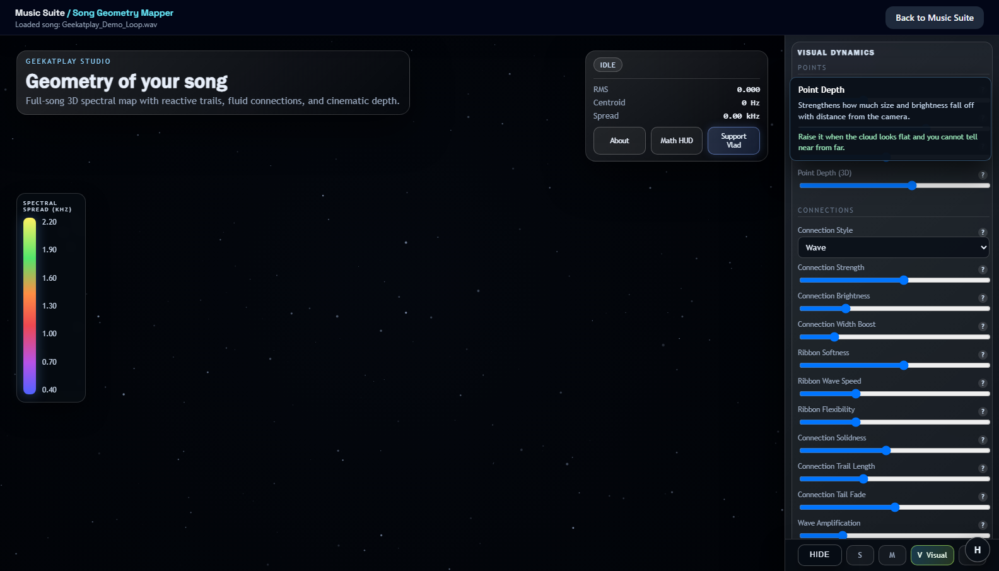

# Geekatplay Studio Music Suite Help Guide

**Created by Vladimir Chopine · Geekatplay Studio**

## 1) Session Control

- `Upload`: stores source audio and metadata.
- `Analyze`: runs offline DSP analysis asynchronously.
- `Use optional GPU spectrogram path`: enables optional CUDA spectrogram route if available.
- `Clear History`: removes completed runs.
- `Hard Reset`: cancels queued/running jobs and clears all runs.
- `Hard Reset` also resets in-process worker state so stalled jobs do not remain pinned at high progress values.

## 2) Analysis Stages (Ticker)

Typical stage flow:

- `uploaded`
- `queued`
- `initialize`
- `metadata`
- `decode`
- `scan`
- `dynamics`
- `markers`
- `spectrograms`
- `charts`
- `report_*`
- `finalize`
- `completed`

If stage heartbeat stalls for too long, loop guard marks the run as failed to prevent silent hangs.

Stage detail text is expected to change during long phases (`spectrograms`, `charts`, `report_*`).
For long spectrogram work, the frontend warning is intentionally less aggressive than the backend loop guard.
If percentage remains fixed and stage detail does not update for an extended period, use `Hard Reset`.

## 3) AI Mastering Controls

- `Mode`
  - `v1`: safest transparent path for dense, lossy, clipped, or peak-sensitive sources
  - `v2`: optimizer variants + best candidate selection for cleaner corrective cases
  - `v3`: stem-aware spectral workflow for difficult but still recoverable material
- `Preset`
  - `streaming`, `club`, `film`, `voice`
- `Backend`
  - `internal`: deterministic built-in DSP chain and current default
  - `auto`: advanced runtime selection path
  - `ffmpeg`: ffmpeg filter-chain pass
  - `pedalboard`: optional pedalboard plugin path
  - `matchering`: optional reference-based path (requires `Reference Run ID`)
- `Target LUFS`: mastering loudness target
- `True Peak dBFS`: output ceiling target
- `V2 Variants`: candidate count for mode `v2`
- `Refine Passes`: bounded marker-aware correction passes (`1..5`)
- `Reference Run ID`: optional analyzed run id to use as mastering reference
- `Source-Aware Adaptation`: before rendering outputs, the engine can nudge de-essing, low/high spectral targets, compression, limiter drive, and peak headroom from detected source issues
- `Iterative Normalization`: output loudness is measured after limiting and searched toward the requested LUFS target while staying under the configured true-peak ceiling
- `Suggested Settings`: analyzer advice now includes safer mode, preset, backend, and refine-pass recommendations

Important behavior:

- Manual `Target LUFS` and `True Peak dBFS` remain the primary user controls.
- Adaptation is conservative and is designed to reduce obvious source problems before the main mastering pass.
- Extra true-peak headroom may be introduced automatically when clipping or high true-peak risk is detected.
- Normalization is no longer a single gain pass; the engine now measures post-limiter loudness and chooses the closest valid result.
- Suggested settings now default to `internal` and lower refine counts unless the source looks clean enough to justify stronger correction.

## 4) Post-Master Self-Check

- `Assessment`
  - `strong_improvement`: major reduction in issue score
  - `partial_improvement`: smaller but measurable improvement
  - `unchanged`: no measurable gain
  - `regression`: quality score worsened; rollback logic should prevent this in final output
- `Issue score X -> Y`: weighted issue classes before/after mastering
- `Resolved`: issue classes removed after mastering
- `Remaining`: issue classes still present
- `Worsened`: issue classes that increased
- `Recommended fixes`: follow-up actions when mastering alone cannot fully resolve issues
- `Compliance`: verifies LUFS target distance, true-peak ceiling distance, and crest-density risk after mastering
- `Post-check rescue`: if the first pass still fails compliance badly, AudioQI can rerender from source with a stricter rescue configuration and keep it only if the result improves

## 5) Refinement Diagnostics

- `accepted / max`: successful correction passes vs configured pass limit
- `rollbacks`: non-improving pass attempts discarded
- `stem fallback applied`: whether stem rescue pass improved result and was kept
- `backend selected`: actual backend used after runtime availability checks
- `source-aware adaptation`: preflight parameter changes applied before the main mastering render
- `recommended backend/refine passes`: analyzer-provided safer starting point for the current source

A pass is accepted only if it improves the weighted marker load **and** does not
materially worsen `harshness_band`, `clipping`, `true_peak_risk`, or
`mono_incompatibility`. Those four are refused regardless of aggregate score,
because added glare or clipping cannot be recovered downstream. A high rollback
count therefore means no safe improvement was available, not that nothing was
tried.

## 5b) Mastering Progress Stages

Mastering reports the step it is starting, so a long job is legible rather than
a single frozen percentage. State also carries `started_at` and
`stage_started_at` so the UI can show how long the *current* step has run.

| Stage | Meaning |
| --- | --- |
| `load_source` | Decoding source audio |
| `profile_source` | Measuring loudness, dynamics, spectral balance |
| `adapt_settings` | Adapting the chain to this material |
| `*_highpass` | Filtering sub-sonic rumble below 24 Hz |
| `*_tilt` | Spectral tilt and tonal balance |
| `*_deess` | De-essing sibilance |
| `*_compress` | Broadband compression |
| `*_limit` | Normalising to loudness and true-peak targets |
| `refine_pass_N` | Marker-aware corrective pass N |
| `rollback` | Last pass was not an improvement and was discarded |
| `stem_fallback` | Stem-rescue pass |
| `self_check` | Re-measuring the finished master |

The chain prefix names which pass is running: `chain_*` for a single master,
`variantN_*` while evaluating optimizer variant N in `v2`, and `stem_bass_*`
and friends while processing stems in `v3`. Limiting is normally the longest
single stage.

## 6) Marker Categories

- `clipping`: hard clip segments
- `true_peak_risk`: true peak exceeds target safety margin
- `loudness_dip`: short-term loudness falls below target window
- `harshness_band`: persistent 3k-9k energy spikes
- `sub_bass_heavy`: excessive 20-80 energy share
- `mono_incompatibility`: negative stereo correlation regions

`harshness_band` and `sub_bass_heavy` are **shares of total energy**, so they
compete: reducing dominant sub-bass lowers total energy and therefore raises the
3–9 kHz share even when the absolute 3–9 kHz content has not changed. Judge a
master by the self-check's `resolved` / `improved` / `worsened` sets together,
not by one marker type in isolation.

## 7) Timeline Selection and Marker Review

- The playhead timeline supports a segment selection (`start`, `end`).
- Marker table near playhead is de-duplicated and prioritized by proximity to current cursor/selection.
- Clicking a marker row jumps playback and updates the active timeline selection.
- Selection-aware charts (waveform, loudness, stereo, spectrogram views) highlight or zoom around the selected window.

## 8) Export, Conversion, and Save Behavior

- Conversion and mastering outputs are generated under run artifacts first.
- Save/download prompts should appear only after processing reaches `completed`.
- A single explicit output selection should trigger a single file save action.
- If multiple save prompts appear unexpectedly, refresh run detail and verify only one output id is selected.

## 8b) Song Geometry Mapper

- **Per-control help**: rest the pointer on any adjustment for about half a second to get a popup describing what it does and when to reach for it. Keyboard focus shows the same help; `Esc` dismisses it.
- **Playback speed**: the Session tab exposes 0.05x-2x plus 0.1x / 0.25x / 0.5x / 1x / 2x presets. `[` and `]` step the rate, `\` returns to 1x, and the choice persists between sessions.
  - Trail persistence, pulse decay, and ribbon motion run on the *audio* clock, so a trail looks the same at 0.25x as at 1x — it simply advances more slowly.
  - Pausing freezes the trail instead of letting it fade, so a single moment can be inspected.
  - `Preserve pitch` is on by default; turn it off for tape-style pitch shifting.
- **Controls are docked** to a resizable right-hand column on displays 900px and wider, so they never cover the geometry. Drag the divider to resize, or use `Hide` to reclaim the full width. Narrower screens keep the original bottom sheet.
- **Song Info** (lower left, toggled from the top bar) shows elapsed/total time, playback rate, position, frame index, a low/mid/high band meter with peak hold, and the estimated tempo and key. Both estimates carry a confidence and read `unclear` rather than printing a number the data does not support.
- **Waveform strip** (top, toggled from the top bar) is the whole song's peak envelope tinted by the active colour metric. Click or drag anywhere in it to seek. Imported and backend-analysed maps have no sample-level envelope, so those fall back to the per-frame RMS curve.
- **Node inspector**: rest the pointer near any node to see that frame's eight descriptors plus a sentence explaining why the current mapping mode put it at that coordinate.
- **Camera**: scroll to zoom (0.12x-4x), drag to orbit or pan, `F` or `Reset Camera` frames the whole cloud.

### How a frame becomes a point in space

Each analysis frame is one node. Eight descriptors are measured per frame — RMS, spectral centroid, spread, rolloff, flatness, zero-crossing rate, peak frequency, and flux — and the mapping mode decides how those eight numbers become three coordinates:

| Mode | X | Y | Z | Answers |
| --- | --- | --- | --- | --- |
| Manifold (PCA) | 1st principal component | 2nd, nudged by loudness | 3rd, nudged by flux | "What sounds like what" — distance is timbral difference, time is not an axis |
| Time Spine | Elapsed time | Peak frequency, lifted by centroid | Spread + tonality + loudness + flux | "What happened when" |
| Hybrid Flow | Time arc blended 62% toward PC1 | Time blended 46% toward PC2 | Arc depth blended toward PC3 | Chronology you can follow, with repeats bending together |
| Helix Orbit | cos(angle) × radius | Elapsed time along the spiral | sin(angle) × radius | Fixed span per turn; loud, wide passages bulge outward |

PCA picks the three directions in which *this* song's descriptors vary most, so the axes carry the most available information rather than being an arbitrary choice of three descriptors. `3D Frequency Spread` scales X and Z, and the X/Y/Z offsets shift the cloud bodily; neither changes what the axes mean.

### Time and structure

- **Temporal Fog** fades nodes by distance from the playhead *in time*, unlike `Fog Depth` which follows the camera — so it keeps working while you orbit.
- **Ghost Layers** draw faint echoes of the cloud N seconds behind (cool) and ahead (warm).
- **Time Tube** extrudes the trail into a ribbon whose thickness is loudness.
- **Section Arcs** link moments that sound alike but sit far apart in the song, taken from the nearest-neighbour graph. A verse/chorus track shows many; a through-composed piece shows almost none. The Math HUD reports how many were found.

### AI music style

The Session tab describes the track's style from its measured features.

- If a local **Ollama** model is running on loopback it writes the description; the panel probes on load and names the model it will use. Vision, embedding and code models are skipped because they cannot describe music usefully.
- A **rule-based description derived from the measurements is always produced and always shown**, even when a model answers. A language model will confidently name a genre the numbers do not support, so both are visible and it stays clear which claims trace to a measurement.
- No local model is a normal state, not an error — the measured description still appears.
- Requests go through the Music Suite API, never from the browser to Ollama directly, and carry explicit time and output-token budgets.

## 8c) Studio Editor

Open it with **Studio Editor** in the workspace (it loads the selected song) or at `/editor`. Sessions save automatically; the original audio is never changed, and every edit can be undone (`Ctrl/Cmd+Z`).

### Layout

- **Toolbar** — transport (play, loop, record), clock, loudness readout, tools (Select `V`, Razor `C`, Range `R`), snapping, automation lane, spectral view, markers, undo/redo, zoom, Import and Export.
- **Track headers** — name, mute, solo, volume, pan and a level meter.
- **Timeline** — clips with waveforms (audio) or notes (MIDI), the ruler with sections and markers, and automation lines when a lane is shown.
- **Inspector** (right) — changes with the selection: the clip and its processing tools, the track's EQ, effects, routing and plugin, or project settings when nothing is selected.
- **Bottom panel** — the piano roll for a MIDI clip (`P`) or the spectral view for an audio clip (`W`).

### Everyday editing

| Do this | How |
|---|---|
| Move or trim a clip | Drag its body, or drag an edge |
| Fade | Drag the small square handles at the top corners of a selected clip; choose the shape in the inspector |
| Split | `S` at the playhead, or the Razor tool |
| Remove time | Highlight with the Range tool, then `Delete`; `Shift+Delete` closes the gap |
| Loop | Shift-drag on the ruler, or highlight a range and press `L` |
| Name a section | Highlight a range, `Shift+R`; then Repeat or Cut out from the inspector |
| Automation | `A` (or the lane menu), click the yellow line to add a point, drag it, double-click to remove |

### Processing tools

Each tool renders a new take beside the original. With several clips selected, the tools run on all of them; **Favourites** saves the last one to three steps as a one-click chain.

- **Separate stems** — 2, 4 or 6 stems on new aligned tracks; the source clip is muted. With AI stem separation installed (see [Models & engines](#models-and-engines)) two more options appear: **Split the drums into kick, snare, toms, hi-hat, ride and crash** and **Split the vocals into lead and backing**. With both ticked a 6-stem split gives 12 tracks. On a drum or vocal stem you already have, **Split this drum stem into kit pieces** and **Split this vocal stem into lead and backing** do just that part. Parts a song does not have (no piano, no toms) come out nearly silent.
- **Repair** — Reduce noise (highlight pure noise first to use it as a noise print), Normalise loudness.
- **Restore** — DeClick, DeHum (finds 50 or 60 Hz itself), DeClip, DeReverb.
- **Spectral view** — drag a box around a sound; *Attenuate* turns it down, *Heal* replaces it with what surrounds it.
- **Pitch and time**, **Warp** (Alt-click a selected clip to pin a moment, drag its dashed line, then *Apply warp*), **Quantise beats**.
- **AI match** — detect tempo and key, then fit the clip to the project or to another clip. Relative keys (A minor / C major) count as a match.
- **Compose** — *Convert to MIDI notes* (best on single lines: vocals, bass, leads) and *Detect song sections*.
- **Generate a part** — needs ComfyUI running on this machine with the Sonic Holodeck nodes.

### Mixing

Every track has a 3-band EQ (frequencies adjustable), gate, voice effect, distortion, compressor, delay and reverb, stereo width and pan. Add **Reverb**, **Delay** or **Group** buses in the project panel, then send tracks to them or route a track's output into a bus. The master has a true-peak limiter (ceiling adjustable); the readout shows integrated, short-term and momentary loudness and the highest true peak for the current playback.

### Voice effects

Turn on **Voice** in a track's effects and pick a preset, or choose the type yourself:

- **Vocoder (robot singer)** — the voice shapes a synth, the classic robot-vocal sound. *Notes* either follows the singing, snapped to semitones (with *Transpose* for an octave down), or holds one note for a monotone robot. Hold keys on a MIDI keyboard while the track plays to choose the notes and chords yourself.
- **Pitch shift** — up for chipmunk or helium, down for a monster. At 50% mix it becomes a harmony.
- **Robot** — a ring modulator; low rates sound like a classic sci-fi robot, high rates metallic.
- **Synth voice** — an oscillator (saw or 8-bit square) that follows the sung pitch and loudness.
- **Vox distortion** — a thin, clipped megaphone or old-radio voice.

Vocoder and synth voice work best on a solo voice. Exports use the saved settings: notes held on a MIDI keyboard shape live playback only and are not part of an export.

### Playing a MIDI keyboard

Plug a USB MIDI keyboard in (Roland and other class-compliant keyboards work without a driver) and press the keyboard button beside the record button. Chrome and Edge ask once for permission to use MIDI devices; Safari has no Web MIDI. The button lights up as you play and its panel lets you pick one keyboard when several are connected.

The keyboard plays the selected track, or the first track with MIDI notes when nothing is selected. Velocity, the sustain pedal and the pitch-bend wheel all work. If that track's voice effect is a vocoder or synth voice, the keys set the robot voice's notes instead of playing the instrument. Select a track that has a MIDI clip (for example from *Add an instrument track*) and press record to record what you play as notes: the take lands in a new clip, whole bars when snapping is on, and on a new track when it would overlap an existing clip.

### Recording

Select a track and press the microphone button. With a range highlighted it becomes a punch-in (2 s pre-roll, stops by itself). With the loop on, each pass becomes a take on its own lane; select a take and choose *Use this take* to comp. The browser asks for microphone access the first time.

### Composing with MIDI

**Sheet music.** Select a MIDI clip and press *Show as sheet music* to read it as written music on a piano's two staves (notes from middle C up on the treble staff), with the project's key signature and time signature, rests, beams and ties across barlines. Timing is rounded to sixteenth notes of the project tempo, so set the tempo first for a tidy page. Click a bar to move the playhead to it. It is a reading view that redraws as the clip changes; notes are edited in the piano roll. Clips longer than 96 bars show their first 96. **Print** opens the print dialog on properly laid-out pages, and **PDF** saves the same pages as a file named after the clip: the clip's name as the title, tempo and key under it, bars as wide as their notes need (busy bars get more room, and each line is filled to the margins) and page numbers when there are several pages. Choose **A4** or **US Letter** next to the buttons (it starts on the usual size for your region). Rename the clip first to set the title.

**On-screen piano.** The piano button in the header (next to the MIDI keyboard button) docks a piano under the timeline. It plays the selected instrument track with the mouse or by touch, slide included, exactly as a MIDI keyboard would: through the built-in synth, or through Surge XT while that is switched on for the track. With the piano open, the record button captures what you play as notes.

*Add an instrument (MIDI) track* in the project panel creates a four-bar clip and opens the piano roll. Click to add notes, drag to move, drag the right edge to resize, right-click to delete, shift-drag to select several. *Note input* lets the keys `A W S E D F T G Y H U J K` or a MIDI keyboard add notes at the playhead. Switch the instrument type to **Drum kit** for a labelled drum grid.

**The synth.** Pick a **Sound** (17 presets from basses to pads, leads, bells and an organ, all at a similar loudness), adjust *Brightness*, *Attack* and *Release*, or press **Edit sound** for everything:

- *Oscillators 1–3*: wave (saw, square, two pulse widths, triangle, sine, organ, hollow, bright), octave, semitones, fine tune, level, unison voices (up to 7), detune and stereo spread.
- *Filter*: low-, high-, band-pass or notch, 12 or 24 dB/oct, cutoff, resonance, drive, key follow, and how far envelope 2 sweeps it.
- *Noise, FM and voice*: a noise source; FM, where oscillator 2 shapes oscillator 1 (bells, electric pianos); poly or mono, where mono plays one note at a time and glides between overlapping notes; velocity response; volume.
- *Envelopes*: envelope 1 shapes the volume, envelope 2 is free for the filter and the modulation routes.
- *LFOs*: two, with five shapes including random steps, free in Hz or locked to the project tempo (1 bar down to 1/16, and triplets).
- *Modulation*: up to 8 routes from LFO 1/2, envelope 2, velocity or the note played to pitch, any oscillator's pitch or level, noise, FM amount, cutoff, resonance, volume or pan, each with a positive or negative amount.

The keyboard at the top of the editor plays the sound. **Save as my sound** keeps it in this browser under its name. Every change is one step in Undo, and the sound is saved with the project and used in exports. Import `.mid` files with Import; export a clip with *Export as a .mid file*.

### Plugins

- **VST3 / Audio Units** — choose one in the clip's Plugins section, set its controls, *Audition 8 s* to hear it, then *Render through plugin*.
- **Instrument plugins (Surge XT and others)** — select a MIDI clip and use its *Plugin instrument* section. No instrument installed yet? Press **Install Surge XT (free)** there, or install it from **Models & engines ▸ Instruments** (the installers also take `MUSIC_SUITE_INSTALL_SURGE=1`): it downloads about 420 MB from the Surge project's official releases, checks every file against a fixed fingerprint and installs the plugin and its 3,000 sounds for your user only, with no administrator password. Then choose the instrument and press **Play**: the clip loops through your speakers. Search the **Sound** list (for example "bass", "pad" or "keys") and click a sound, or step through the list with the arrow keys, to hear each one straight away; the sound you pick is kept with the track. **Stop** ends playing. **Play it from your MIDI keyboard** switches the plugin on without the loop: a connected MIDI keyboard then plays Surge XT instead of the built-in synth, and pressing record captures what you play as notes on the track (or on a new track if that stretch is taken), ready to render. For deeper changes, **Edit in Surge XT's window** opens the plugin's own controls on this computer (the window may sit behind the browser); Play and Stop work there too, and **Keep this sound and close the window** keeps what you changed. Pick sounds from the editor's list rather than Surge's own patch menu, which does not take a pick in this host. Finally **Render this clip with Surge XT**: the result lands on a new audio track under the MIDI one, which is muted so it is not heard twice. While you write notes the built-in synth plays them; render again after editing. Any other VST3 or Audio Unit instrument works the same way, without the Sound list.
- **In-browser plugins (Web Audio Modules)** — in a track's inspector. They are downloaded from the internet and stay off until you allow them in that browser. A plugin runs inside the editor page and can see the open session; load only plugins you trust.

### Export

*Export* offers the mixdown as WAV 24-bit, WAV 32-bit float, FLAC or MP3, the highlighted range, every track separately, *Send mix to the analyser and mastering* (adds the mix to the workspace as a new run, starts its analysis and opens it), or *Start an AI song from the mix* (opens AI Song Studio with the mix as the song to start from).

## 8c-2) Synth Studio

Open **Synth Studio** from the workspace or from any studio's header. It is a page for designing and trying sounds, with two tabs.

**Music Suite synth.** The suite's own synth with every control on one page: oscillators, filter, noise and FM, envelopes, LFOs and modulation routes. Play it on the piano with the mouse, by touch (slide across keys), or by typing `A`–`L` (black keys on the row above; `Z` and `X` move the typing octave). The piano shows more octaves on a wide screen and fewer on a phone. *Load a preset* starts from a factory sound or one of yours, *Save as my sound* keeps the sound in this browser, and *New sound* starts again. Sounds saved here appear under **My sounds** on instrument tracks in the Studio Editor. The page remembers the sound you were working on. **Export** saves the sound as a small `.mssound` file to back up or share; **Import** opens one. The same two buttons are in the Studio Editor's sound editor.

**Surge XT and plugins.** Choose an installed instrument, press **Play** to loop a short phrase through your speakers, and click through Surge XT's 3,000 sounds (search or arrow keys) to hear each one. **Stop** ends the loop. The piano under the list plays the instrument live: the first key switches it on, and *Turn off* ends it. **Connect a MIDI keyboard** in the header lets a USB or Bluetooth keyboard play whichever tab is open, with velocity, sustain pedal and pitch bend. The suite's own synth holds up to 12 keys at once (the oldest gives way), so a rich sound cannot overload the browser. A key is heard about 15–25 ms after it is pressed; Bluetooth headphones add their own delay, so wired headphones or speakers feel tighter for playing. Press the **star** to keep a sound in *Favourites* at the top of the list, here and on MIDI clips in the Studio Editor, which is how a sound found here gets into a song. **Export sound** saves the current plugin sound, including changes made in the plugin's own window, as a `.mssound` file, and **Import sound** opens one; a file for a different instrument is refused with a message. If no instrument is installed, the tab links to Models & engines.

## 8d) AI Song Studio

Open **AI Song Studio** from the workspace. It has three tabs.

**Create**

- *Start from a song* (optional): see [Starting from a song](#starting-from-a-song) below.
- *Start from an idea*: type what the song is about and press **Write style and lyrics**. A language model on this computer fills in the title, style description, lyrics, tempo, key and length. This takes about 30 seconds. Everything it writes can be edited.
- *Style description* is the only required field. Say the genre, mood, instruments, kind of voice and production.
- *Lyrics*: use the **+ Verse**, **+ Chorus** buttons to add section tags; the model follows them. Leave the lyrics empty to let the model write them, or tick **Instrumental**.
- *Tempo, Key, Time signature, Length*: leave on **Auto** to let the model choose.
- *Versions to make*: up to four takes of the same song. Each uses the next seed.
- *Seed*: −1 is random. **Keep this seed** on a result makes the next song start from the same point.
- *Change the lyrics*: type an instruction such as "add a bridge" or "translate to Spanish" and press **Rewrite**.
- **Generate** shows progress and a **Cancel** button. Only one song generates at a time.
- Results play in the page. **Open in Studio Editor** opens the song's project with each version on its own track (extra versions start muted). Under each version: **Add to a session**, **Split into stems**, **Analyse** and **Start a song from it** (see [Moving songs between the workspaces](#moving-songs-between-the-workspaces)).

**History** lists every song with the settings that made it. **Use these settings** loads them back into the form; the same four buttons work on its first version.

**Settings**

- *Local music engine*: install it, see whether it is loaded, or **Unload now** to free its memory.
- *Lyrics and style writer*: which Ollama model writes lyrics, and a button to download it.
- *Keeping your computer responsive*: generation will not start when free memory is below the limit you set, and the engine unloads after the idle time you set.
- *Loudness of new songs*: each new song is levelled towards −14 LUFS, never above −1 dBTP. Change the target or switch it off.
- *High-quality model*: **Download high-quality model** adds the larger XL music model (4.9 GB). With it installed, new songs use it unless you untick *Use the high-quality (XL) model*. It is a little slower and uses a little more memory; AI edits keep the standard model.
- *Google Lyria*: paste a Gemini API key under *Online services* to use Lyria 3.5 (full songs) or Lyria 3 Clip (30 seconds). Every Lyria song carries Google's inaudible SynthID watermark.
- *Generators*: switch engines on or off. *ACE-Step 1.5 (your own Python server)* is for computers that already run ACE-Step's server (start it with `uv run acestep-api`). *YuE2* needs an NVIDIA GPU with about 24 GB and the `MUSIC_SUITE_YUE2_PYTHON` setting, and every song asks you to confirm its non-commercial licence.
- *Online services*: paste your own ElevenLabs or fal.ai API key and press **Save key** to switch that service on. It then appears in the *Generator* list. Your style text and lyrics are sent to it and it bills your account. A clip's audio is uploaded only when you tick *Allow uploading this clip* in an AI edit. A cost estimate appears next to **Generate** before anything is sent. **Remove key** switches it off again. Keys are stored in your computer's keychain and are never shown again.

### Starting from a song

The **Start from a song** panel at the top of *Create* turns a song you already have into the starting point for a new one.

1. **Bring the song in.** Press **Choose a song file**, or send one here: **Make a song from this** in the analyser, **Start a song from it** under a result or history entry, or *Export ▸ Start an AI song from the mix* in the editor. A file you upload is put on a track in a new session (or in the editor's session, when you came from there).
2. **It is read.** Tempo, key, time signature and length are measured, and a style description is drafted from the sound (tempo feel, major or minor, dark or bright, percussive or smooth, bass weight, loudness). These fill the form. The description names no genre or instruments, because those are not measured: add them yourself.
3. **Choose what to make from it:**
   - **New song in its style**: a brand-new song with the same tempo, key, length and feel. The original stays untouched.
   - **Restyle**: the same song in the style you describe. *How much of the original to keep* and *Stay close to the original* control how far it moves.
   - **Extend**: new music before the start or after the end.
   - **Extract an instrument**: one instrument recreated on its own track, for sampling or practice.
   - **Add a part**: a new part (drums, bass, guitar…) written to fit over the song.
   - **Build a full song around it**: a full arrangement around a single part, such as a vocal or a riff.

   The last three need the editing model (2.4 GB) from *Settings*. Online generators offer only the tasks they support.
4. **Generate.** Results go into the song's own session on new tracks. For *New song in its style* and *Restyle* the original's track is muted so you hear the new version first; nothing is deleted.

**Split into stems in the editor** opens the session and separates the song into vocals, drums, bass and the rest. **Analyse it** sends a copy to the analyser.

### Moving songs between the workspaces

A song can go from any workspace to any other, and it is always added, never swapped in:

- **To the Studio Editor:** **Add to a session** (creator), **Studio Editor** (analyser) and a session link all lead to *Where should this song go?*. Choose **New session**, or **Add here** on any existing session to put it on a new track there. Tick **Split it into stems when it opens** to have it separated as soon as the session opens, and choose **How far**: 2, 4 or 6 stems, or *Everything* (12 stems with drum kit pieces and lead/backing vocals, when AI stem separation is installed). The stems go on tracks below the original, which is muted.
- **To the analyser:** **Analyse** (creator) and *Export ▸ Send mix to the analyser and mastering* (editor) copy the audio into a new run, start the analysis and open it.
- **To the AI Song Studio:** **Make a song from this** (analyser), **Start a song from it** (creator results and history) and *Export ▸ Start an AI song from the mix* (editor) open the studio with that song as the one to start from.

### Albums

The **Album** tab makes several songs in one go.

1. Give the album a title, say what it is about, and set a shared style.
2. Write one song idea per line (up to 20).
3. Choose a length per song, and whether it is instrumental.
4. Keep **Write lyrics and style for each song** on to have the lyrics model write each song from the album concept and its idea. Anything you set yourself wins over what it writes.
5. Press **Make N songs**.

The songs are made one after another in the background, so you can leave the page or the computer. If memory runs low, the album waits instead of failing; if Music Suite restarts, the album carries on. A song that fails is marked and the rest continue. **Stop** ends an album early. **Open in Studio Editor** puts the finished songs one after another, each on its own track, in the album's project. For online generators, the estimated cost of the whole album is shown before you start.

### Song plans (ElevenLabs)

With ElevenLabs chosen as the generator, a **Song plan** panel lets you write the song section by section: a name (Verse, Chorus…), the lyrics for that section, its length (3–120 s), styles to use and to avoid, and how closely it should follow its neighbours. **Draft a plan (free)** asks ElevenLabs for a plan from your description, which you can then edit. The first section's styles set the genre, so give it several. With a plan, the *Length* and *Lyrics* fields above it are not used. A plan needs the Music 2 or Music 2.5 model.

### AI edits in the Studio Editor

Select a clip; the side panel has an **AI edit** section.

- **Regenerate a section:** highlight part of the clip with the Range tool (R), switch back to Select (V), click the clip, describe the style and press the button. Only the highlighted part changes.
- **Extend:** adds 10–60 seconds of new music before or after the clip, continuing it.
- **Restyle:** plays the clip in a new style. *Keep* sets how much of the original survives; *Stay close to the original* keeps melody and timing and changes the production.
- **Extract an instrument / Add a part / Build a full song around it:** each result goes on a new track under the clip. These need the editing model (2.4 GB) from AI Song Studio ▸ Settings. Extracted parts are recreated by the AI rather than cut out of the mix, so for exact stems use **Separate into stems**. Build a full song works best on a single part, such as a vocal.
- **Versions:** ask for up to 4. The first lands in place; the others go on muted tracks so you can compare them.
- **Generator:** when ElevenLabs is set up, choose it in the panel to regenerate a section (3–120 s) or extend a clip with ElevenLabs. A clip that was not made with ElevenLabs must be uploaded first, which ElevenLabs bills like generating the same length; tick **Allow uploading this clip** to agree. The cost is shown before you press the button, and the same clip is never uploaded twice.
- Every AI edit is one step in Undo.

## 8e) Models and engines

Open **Models & engines** from any workspace (or go to `/models`). It shows this computer's graphics card and whether PyTorch, which runs the AI models, will use it.

- **AI stem separation**: press **Install AI stem separation**. On Windows with an NVIDIA card it installs PyTorch's CUDA build (about 3 GB); otherwise a smaller CPU or Apple build. The ticked models download afterwards (2.2 GB for all five): Demucs v4 for 4 stems, Demucs v4 6-stem for guitar and piano, BS-RoFormer for vocals and instrumental, DrumSep for drum kit pieces, and Mel-RoFormer Karaoke for lead and backing vocals. A model you leave unticked downloads the first time a split needs it. **Delete downloaded models** frees their space; they download again when needed. Reload any open editor page after installing.
- **AI music (AI Song Studio)**: the music engine, the editing model, the XL model and the lyrics writer, each with an **Install** button.
- Nothing already installed is changed: every installed package is pinned while an install runs. If an install cannot fit, it stops and shows pip's explanation under **Install log**.
- From a terminal in the Music Suite folder: `.venv\Scripts\python -m audioqi.addons list` shows what is installed, and `... install stems` installs the stem pack (`--models none`, `all`, or a list of model files).

## 9) Troubleshooting

### AI Song Studio

- **"The local AI music engine is not installed yet"** — press **Install local engine**. It needs about 6 GB of free disk and an internet connection, once.
- **The install stops with a message about CMake or command line tools** — on macOS run `xcode-select --install`, then press the button again. The message names anything else that is missing.
- **"Only N% of memory is free"** — close some apps or browser tabs and press Generate again, or lower the limit in Settings.
- **Lyrics come out short or ignore the idea** — Ollama is not running or its model is not downloaded, so the simpler built-in planner wrote them. Start Ollama and download the model from Settings.
- **"rejected the API key" / "no credit left"** — the online service refused the request. Check the key and your balance on the provider's site; **Terms and pricing** in Settings links there.
- **The song ignores some lyrics or sings them unclearly** — try another seed or a second version; shorter lines and clear section tags help.

### Studio Editor

- **No stems, poor stems or slow stems** — install the `editor-ai` extra; without it the editor uses a basic built-in split (2 or 4 stems only).
- **Recording does not start** — allow microphone access for the page in the browser, and check no other app holds the input exclusively.
- **"ComfyUI is not running"** — start ComfyUI on this machine with the Sonic Holodeck nodes installed, then press *Check again*. Set `MUSIC_SUITE_COMFYUI_URL` if it is not on port 8188; it must be a loopback address.
- **An in-browser plugin did not load or was left out of an export** — some community plugins do not support every browser or offline rendering; the editor names any plugin it had to leave out.
- **Chords come out wrong in Convert to MIDI** — the built-in transcriber follows one note at a time. `basic-pitch` handles chords but cannot yet be installed on Python 3.13 or newer.

### General

- `Failed to fetch`:
  - confirm the API is running; startup prefers port `8008` but auto-selects the next free loopback port
  - the browser always calls the same-origin `/suite-api` proxy, so no public API URL needs to be configured
  - check the selected API port in `.music-suite-processes.json` and the launcher output
- `<service> did not open port <n> within <n> seconds`:
  - a cold first start imports the full audio stack and can take minutes on a slow disk or while antivirus scans `.venv`
  - read `logs/api.log`, `logs/api.error.log`, or `logs/web.log` for the real failure
  - raise the limit: `.\start.ps1 -StartupTimeoutSeconds 600`, or `MUSIC_SUITE_STARTUP_TIMEOUT_SECONDS=600 ./start.command`
- `npm error enoent ... package.json` when running `npm run start`:
  - run it from the project root, which now provides `npm start` and `npm stop` wrappers around the unified launchers
- `Stage heartbeat is stale`:
  - long mel spectrogram work can legitimately take time
  - the frontend warning is advisory; the backend loop guard is the actual stall detector
  - if a fresh run still stays pinned on `Computing mel spectrogram.` for several minutes, capture the new run id before using `Hard Reset`
- `Mastering looks stuck on one percentage`:
  - it is almost certainly still working. Mastering reports each step it starts and how long that step has been running, so check whether the in-stage timer is advancing before assuming a hang
  - the limiting step (`Normalising to loudness and true-peak targets`) is the longest single stage — on the order of 20 s per minute of audio — so on a full-length track it holds one percentage for a while
  - `v2` runs the whole chain once per optimizer variant, so its total time scales with `Optimizer Variants`
  - a genuinely hung job stops updating `stage_started_at`; the loop guard in `GET /runs/{id}/mastering` is the authority, not the bar
- `Mastering unchanged`:
  - inspect `Source-Aware Adaptation` and `Post-Master Self-Check` together
  - increase `Refine Passes` — the default of 1 applies the marker-aware correction only once, and harshness and sub-bass corrections benefit from iterating
  - move from `v1` to `v2` or `v3`
  - review remaining markers and apply mix-level fixes
  - passes that materially increase harshness, clipping, true-peak risk, or mono incompatibility are refused outright, so a run that reports several rollbacks may simply have found no safe improvement to make
- `More harshness_band markers after mastering than before`:
  - check the absolute change, not just the count. `harshness_band` (3–9 kHz) and `sub_bass_heavy` (20–80 Hz) are both measured as a share of **total** energy, so they compete arithmetically
  - correcting a bass-heavy master reduces total energy, which raises the 3–9 kHz share even when the absolute 3–9 kHz content has not moved at all. A master that takes `sub_bass_heavy` from 71 windows to 2 will often show more `harshness_band` windows purely for this reason
  - read the `Post-Master Self-Check` counts as a set: `resolved`, `improved` and `worsened` together describe the trade, where one marker type alone does not
  - genuine added glare shows up as an increase in absolute 3–9 kHz energy, not only in the ratio
- `Noise floor shows N/A`:
  - the floor can only be read where the music drops out (fades, gaps, quiet intros at least 40 dB below the track's median level); a dense track has none, and the music masks its own noise
  - `Gaps are digital silence` means the quiet passages are exact zeros, so there is no floor to measure
  - `Re-analyze to measure` means the run predates the current estimator, which reported the quietest music as the floor
- `Compression Loss Estimate reads 0 Hz on a 48 kHz file`:
  - correct: loss is measured against 20 kHz (the audible top), not Nyquist. The band between 20 kHz and 24 kHz was never audible content
  - a lossless file showing several kHz of loss was probably transcoded from MP3/AAC before it was saved losslessly
- `Mastered AI-generated track is still flagged by AI-music detectors`:
  - expected. Detectors look for generator fingerprints (periodic spectral peaks from neural vocoders, stem-level vocal signatures), and EQ, compression and limiting leave those intact
  - mastering improves how a track sounds, not how it was made; the suite does not try to hide AI origin
  - to get a genuinely human-made or hybrid result, replace generated parts with performed ones (MIDI re-rendered through your own instruments, a re-recorded vocal) and label AI involvement where platforms ask for it
- `matchering not used`:
  - install optional `pro` extras
  - provide valid `Reference Run ID`
- `backend fallback`:
  - check `Pro modules` availability in mastering panel
- Audio sounds distorted only in app player:
  - verify source endpoint is streaming full file and browser is not pinned to a stale partial cache entry
  - check run metadata duration against source duration from media player/ffprobe
- Frequent `206 Partial Content` in API logs:
  - expected for browser media scrubbing/range requests; this does not mean the source file is truncated
