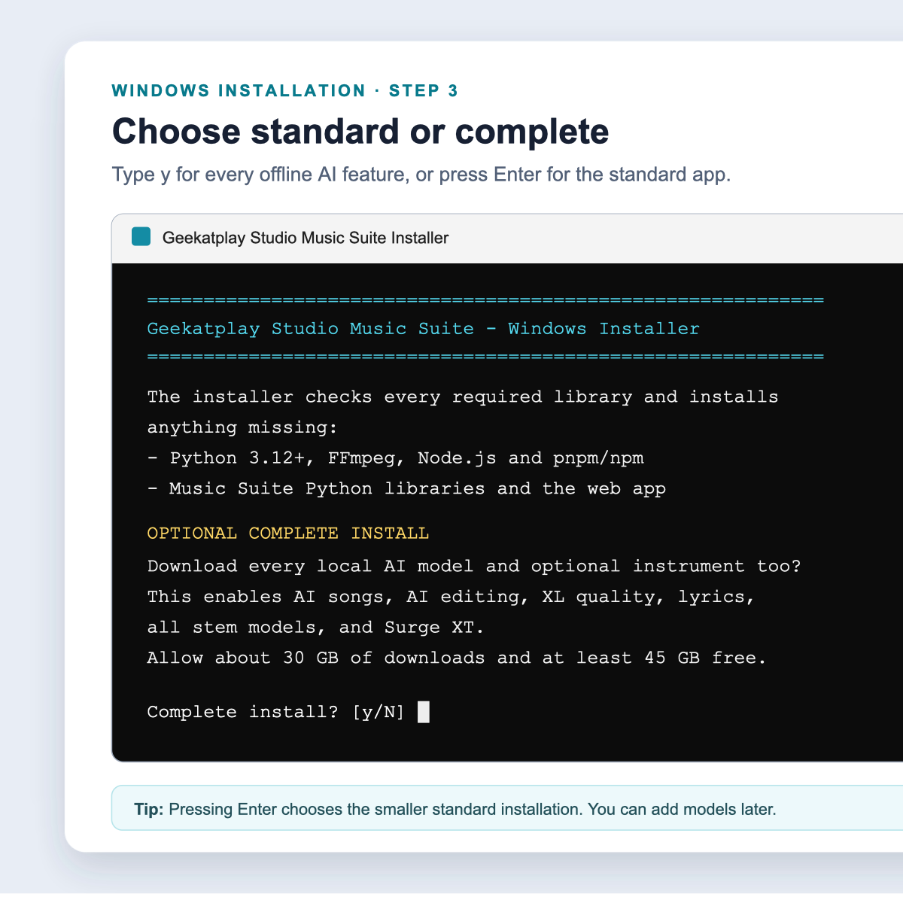
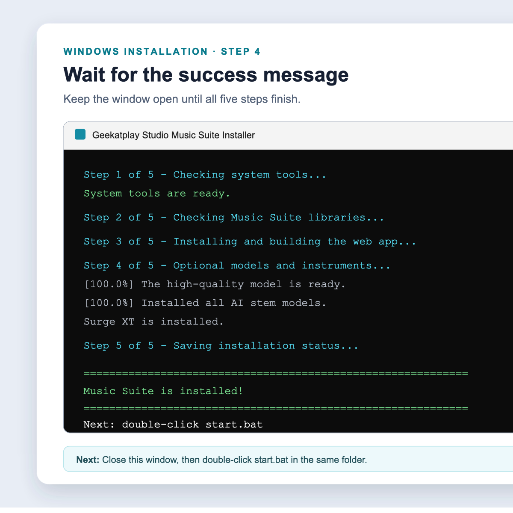

# Music Suite installation on Windows

This guide is for someone who has never installed software from GitHub. You do not need Python, FFmpeg, Node.js, Git, or programming experience before you begin.

## Download and extract

1. Select **[Download Music Suite for Windows](https://github.com/GeekatplayStudio/music-suite/archive/refs/heads/main.zip)**.
2. When the download finishes, open File Explorer and find `music-suite-main.zip` in **Downloads**.
3. Right-click the ZIP and select **Extract All…**, then **Extract**. Do not open or run the installer from inside the ZIP preview.
4. Open the new `music-suite-main` folder. You should see `install.bat`, `start.bat`, and `stop.bat`.

## Install

1. Double-click **`install.bat`**. Keep the black window open.
2. If Windows SmartScreen appears, select **More info**, check that the file came from the official Geekatplay Studio repository, and select **Run anyway**.
3. At **Complete install? [y/N]** choose one:
   - Press **Enter** for the standard app. This is the quickest way to start. AI engines and models can be added later from **Models & engines**.
   - Type **`y`** and press **Enter** for all local AI engines, models, stem tools, the lyrics writer, and Surge XT. Allow about 30 GB of downloads and at least 45 GB of free space.
4. Wait for **Music Suite is installed!**. On a slow connection or while Windows Defender scans new files, this can take a long time. Do not close the window merely because one download pauses for a few minutes.
5. Double-click **`start.bat`**. The app opens in your browser. Keep the startup window open while using Music Suite.
6. Double-click **`stop.bat`** when finished.





## Starting never re-installs

`start.bat` starts Music Suite. It does not download anything and it never asks you to
choose an installation size — that question belongs to `install.bat` alone.

Two things can happen when you start:

- **Something is genuinely missing** (the Python environment, the web app's libraries, or
  the built web app). Startup lists exactly what is missing, then installs only those core
  pieces. Optional AI models are not touched; add those from **Models & engines** in the
  app whenever you want them.
- **A dependency list changed** since you last installed — a new Python package in
  `pyproject.toml`, or a new `pnpm-lock.yaml`. Startup says so and **starts anyway** with
  what you already have. Run `install.bat` when you want to pick the change up.

Editing the project, switching branches, or committing does not make Music Suite reinstall
itself. Only the dependency lists are compared, not the version number, the description,
the authors, or the commit you happen to be on.

## You do not need to install FFmpeg manually

The FFmpeg website primarily publishes source code and links to several Windows builds, so it is easy to download a command-line program and mistake its brief black window for an installer. Music Suite now handles this automatically.

When FFmpeg is not already on the computer, the installer downloads the Windows Essentials ZIP linked by the official FFmpeg project, verifies the publisher's SHA-256 checksum, and keeps FFmpeg inside the Music Suite `.tools` folder. Nothing is installed on Windows: `start.bat` finds it automatically, and no PATH editing is needed.

Node.js and Git work the same way: private, checksum-verified copies in `.tools`, never a Windows install. Windows Package Manager (`winget`) is not used for any of them.

## Python comes with Music Suite

You do not need Python on the computer, and an existing one is left alone. Like ComfyUI's portable build, Music Suite keeps its own Python 3.12 inside its folder (`.tools\python`): the installer downloads python.org's official build (published as a package on `api.nuget.org`, about 14 MB), checks it against a fixed SHA-256 fingerprint and the Python Software Foundation's signature, and unpacks it. Nothing is installed on Windows, no administrator password is asked, and PATH is not changed. Only when that download is impossible does the installer use a Python 3.12 or newer already on the computer, as it is; it never installs Python on Windows.

## Nothing outside the Music Suite folder

Like ComfyUI Portable, Music Suite keeps what it adds in its own folder: its Python and tools in `.tools`, download caches (pip, pnpm, npm) in `.cache`, model caches in `data\cache`, and Surge XT, when you install it from **Models & engines**, in `data\plugins\VST3`, where your DAW does not see it (tick **Also make it available to my other music programs** if you want it there). Deleting the folder removes Music Suite completely. Only the optional complete install adds programs to Windows: Ollama for the lyrics writer, and CMake and the C++ build tools for the AI music engine; the installer says so before you choose it.

If you move or rename the Music Suite folder, run `install.bat` once more (or just `start.bat`): it notices that the app's Python environment points to the old place and rebuilds it.

## If the installer window closes straight away

Double-click `install.bat` in the **extracted** folder. Opened straight from the ZIP, it now says so and asks you to extract the ZIP first (right-click ▸ **Extract All...**). If you start `install.ps1` with **Run with PowerShell**, its window now stays open until you press Enter, so any error can be read. The full record of every install is in `logs\install.log`.

## If `winget` reports certificate error `0x8a15005e`

That error belongs to Windows Package Manager's repository connection, not Music Suite or your internet speed. The standard Music Suite installation does not use `winget` at all; only the optional complete install does, for Ollama, CMake and the build tools.

The optional AI music engine also explicitly selects the `winget` community source for CMake, avoiding the older “several packages were found; specify a source” failure. If Windows still cannot install optional CMake, Build Tools, or Ollama:

1. Finish or use the standard app first; analysis, editing, mastering, visualization, MIDI, and basic stems do not require the local music generator.
2. Open **Microsoft Store**, find **App Installer**, and update it.
3. If the source remains broken, open **PowerShell as Administrator** and run:

   ```powershell
   winget source reset --force
   winget source update
   ```

4. Run `install.bat` again, or retry the engine from **AI Song Studio → Settings**.

Do not disable certificate validation. A certificate mismatch can also be caused by an intercepting corporate proxy, antivirus HTTPS inspection, a VPN, or an incorrect Windows date/time.

## If files do not download

1. Keep the extracted folder in a normal writable location such as `Documents\Music Suite`; do not use the ZIP preview, `Program Files`, or a read-only network folder.
2. Check that the Windows clock, date, and time zone are correct.
3. Temporarily disconnect a VPN or ask the network administrator whether HTTPS downloads from these official services are allowed: `github.com`, `api.github.com`, `api.nuget.org`, `python.org`, `nodejs.org`, `gyan.dev`, `pypi.org`, `files.pythonhosted.org`, `registry.npmjs.org`, and `huggingface.co`.
4. Make sure at least 10 GB is free for the standard app, or 45 GB for the complete installation.
5. Run `install.bat` again. It reuses completed work and retries missing parts.

## If `start.bat` fails

Run `install.bat` once more first. Installation output is saved in `logs\install.log`. If startup still fails, inspect `logs\api.error.log` and `logs\web.error.log`. The startup window also prints the last useful log lines instead of closing silently.

When asking for help, include:

- Windows 10 or 11 and whether the computer is Intel/AMD or ARM;
- standard or complete installation;
- the exact final error text or a screenshot;
- the last 20 lines of `logs\install.log` or the relevant startup log.

Do not post API keys, passwords, the contents of `.env` files, or private audio.
