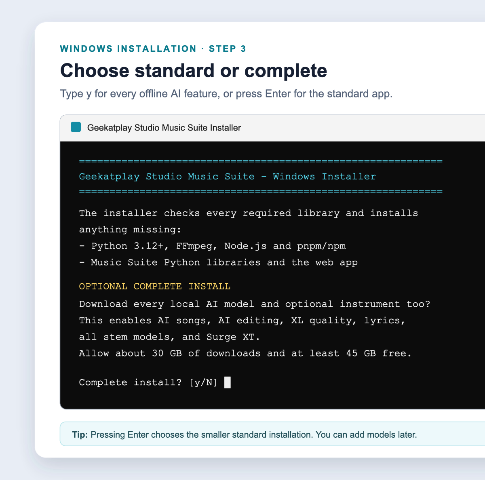
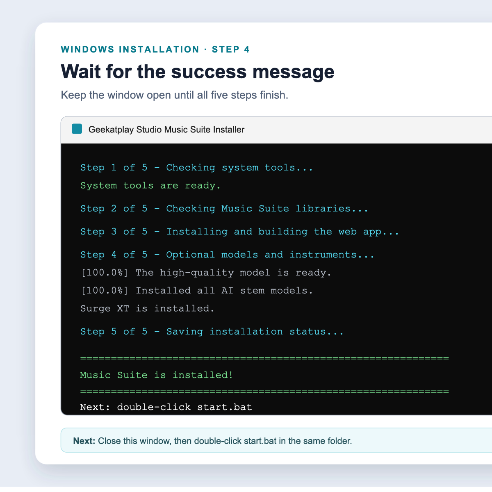

# Установка Music Suite в Windows

Инструкция рассчитана на новичка. Заранее устанавливать Python, FFmpeg, Node.js или Git не требуется.

## Скачать и распаковать

1. Нажмите **[Скачать Music Suite для Windows](https://github.com/GeekatplayStudio/music-suite/archive/refs/heads/main.zip)**.
2. Найдите файл `music-suite-main.zip` в папке **Загрузки**.
3. Нажмите по ZIP правой кнопкой мыши, выберите **Извлечь всё…**, затем **Извлечь**. Не запускайте установку из окна просмотра ZIP-архива.
4. Откройте новую папку `music-suite-main`. В ней должны быть файлы `install.bat`, `start.bat` и `stop.bat`.

## Установить и запустить

1. Дважды щёлкните **`install.bat`** и не закрывайте чёрное окно.
2. Если появился SmartScreen, нажмите **Подробнее**, убедитесь, что архив скачан из официального репозитория Geekatplay Studio, и выберите **Выполнить в любом случае**.
3. На вопрос **Complete install? [y/N]**:
   - нажмите **Enter** для обычной установки — это самый быстрый вариант; AI-модели можно добавить позже в разделе **Models & engines**;
   - введите **`y`** и нажмите **Enter**, чтобы скачать все локальные AI-движки, модели, разделение на стемы, модель текстов и Surge XT. Понадобится около 30 ГБ загрузок и минимум 45 ГБ свободного места.
4. Дождитесь сообщения **Music Suite is installed!**. На медленном соединении или во время проверки Windows Defender установка может надолго остановиться на одном проценте — не закрывайте окно.
5. Дважды щёлкните **`start.bat`**. Программа откроется в браузере. Пока вы работаете, окно запуска должно оставаться открытым.
6. Для завершения дважды щёлкните **`stop.bat`**.





## FFmpeg вручную скачивать больше не нужно

На сайте FFmpeg опубликован исходный код и несколько вариантов сборок для Windows. Скачанный `ffmpeg.exe` — консольная программа, а не мастер установки, поэтому чёрное окно быстро появляется и исчезает. Это не устанавливает FFmpeg в систему.

Теперь Music Suite делает всё сам. Если FFmpeg на компьютере нет, установщик скачивает Windows Essentials ZIP, на который ссылается официальный сайт FFmpeg, проверяет контрольную сумму SHA-256 и сохраняет FFmpeg внутри папки Music Suite `.tools`. В Windows ничего не устанавливается: `start.bat` найдёт программу сам, менять PATH не нужно.

Так же устроены Node.js и Git: собственные проверенные копии в `.tools`, никакой установки в Windows. Windows Package Manager (`winget`) для них не используется.

## Python входит в Music Suite

Устанавливать Python на компьютер не нужно, а уже установленный не затрагивается. Как портативная сборка ComfyUI, Music Suite хранит собственный Python 3.12 в своей папке (`.tools\python`): установщик скачивает официальную сборку python.org (она опубликована пакетом на `api.nuget.org`, около 14 МБ), сверяет её с фиксированной контрольной суммой SHA-256 и цифровой подписью Python Software Foundation и распаковывает. В Windows ничего не устанавливается, пароль администратора не нужен, PATH не меняется. Только если эту загрузку получить нельзя, установщик использует уже установленный Python 3.12 или новее как есть; сам он никогда не ставит Python в Windows.

## Ничего за пределами папки Music Suite

Как портативная ComfyUI, Music Suite держит всё, что добавляет, в своей папке: Python и инструменты — в `.tools`, кэши загрузок (pip, pnpm, npm) — в `.cache`, кэши моделей — в `data\cache`, а Surge XT, если поставить его из **Моделей и движков**, — в `data\plugins\VST3`, где ваша DAW его не видит (отметьте **Сделать доступным и в других музыкальных программах**, если он нужен и там). Удалив папку, вы удалите Music Suite полностью. Программы в Windows добавляет только необязательная полная установка: Ollama для автора текстов, CMake и инструменты сборки C++ для музыкального ИИ-движка — установщик предупреждает об этом до выбора.

Если вы перенесли или переименовали папку Music Suite, запустите `install.bat` ещё раз (или просто `start.bat`): он заметит, что окружение Python указывает на старое место, и пересоздаст его.

## Если окно установщика сразу закрывается

Запускайте именно `install.bat` двойным щелчком из **распакованной** папки. Если открыть его прямо из ZIP-архива, установщик теперь сообщит об этом и попросит сначала распаковать архив («Извлечь все…»). Если вы запускаете `install.ps1` через «Выполнить с помощью PowerShell», окно теперь тоже не закрывается, пока вы не нажмёте Enter, так что сообщение об ошибке можно прочитать. Полный журнал установки лежит в папке `logs\install.log`.

## Ошибка `winget` `0x8a15005e` о сертификате

Это ошибка подключения Windows Package Manager к его репозиторию, а не Music Suite и не скорости интернета. Обычная установка Music Suite `winget` вообще не использует; он нужен только необязательной полной установке — для Ollama, CMake и инструментов сборки.

Для CMake установщик AI-движка теперь явно указывает источник `winget`, поэтому ошибка «найдено несколько пакетов, укажите --source» также исправлена. Если дополнительные CMake, Build Tools или Ollama всё ещё не устанавливаются:

1. Сначала пользуйтесь обычной версией Music Suite. Анализ, редактор, мастеринг, визуализация, MIDI и базовое разделение на стемы работают без локального генератора музыки.
2. Откройте **Microsoft Store**, найдите **App Installer / Установщик приложений** и обновите его.
3. Если источник всё ещё повреждён, запустите **PowerShell от имени администратора** и выполните:

   ```powershell
   winget source reset --force
   winget source update
   ```

4. Снова запустите `install.bat` или повторите установку движка в **AI Song Studio → Settings**.

Не отключайте проверку сертификатов. Несовпадение сертификата также может вызвать корпоративный прокси, HTTPS-проверка антивируса, VPN или неправильные дата и время Windows.

## Если файлы не скачиваются

1. Поместите распакованную папку, например, в `Документы\Music Suite`. Не запускайте из ZIP, `Program Files` или папки только для чтения.
2. Проверьте дату, время и часовой пояс Windows.
3. Временно отключите VPN. Для установки должны быть доступны официальные адреса: `github.com`, `api.github.com`, `api.nuget.org`, `python.org`, `nodejs.org`, `gyan.dev`, `pypi.org`, `files.pythonhosted.org`, `registry.npmjs.org` и `huggingface.co`.
4. Освободите минимум 10 ГБ для обычной установки или 45 ГБ для полной.
5. Снова запустите `install.bat`: готовые компоненты сохранятся, а недостающие загрузятся повторно.

## Если не запускается `start.bat`

Сначала ещё раз запустите `install.bat`. Журнал установки сохраняется в `logs\install.log`. Если ошибка осталась, посмотрите файлы `logs\api.error.log` и `logs\web.error.log`. Окно запуска также показывает последние полезные строки журнала.

При обращении за помощью укажите версию Windows, тип компьютера Intel/AMD или ARM, обычную или полную установку, точный текст последней ошибки и последние 20 строк журнала. Не публикуйте API-ключи, пароли, содержимое `.env` и личные аудиозаписи.
